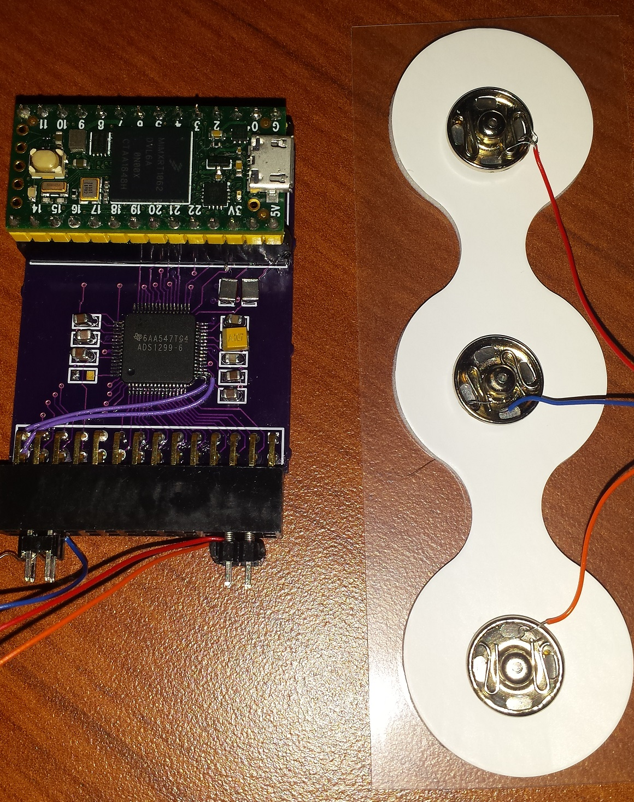
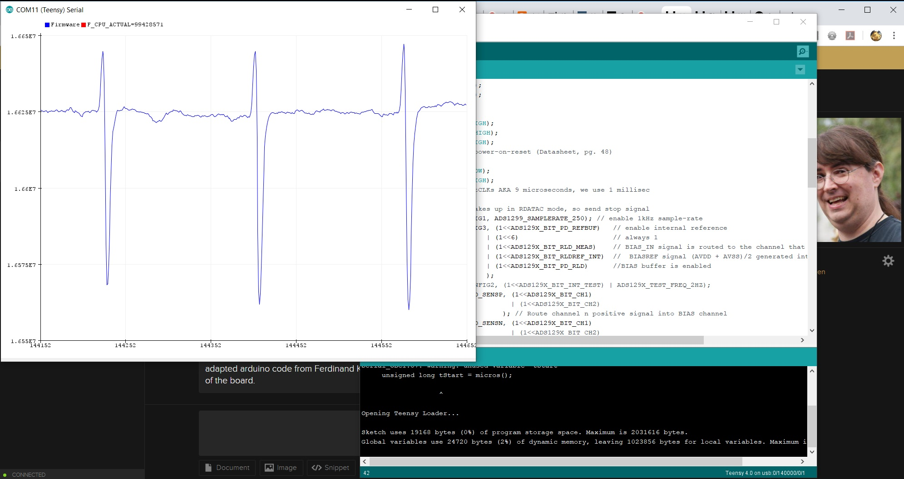

# ADS129X

Driver and sketches for the Texas Instruments **ADS1299-4 / ADS1299-6 / ADS1299** on a **Teensy 3.6, 4.0, or 4.1**, plus a Classic-Bluetooth sketch for the **original ESP32** (ESP32-WROOM-32E or ESP32-PICO, for example the Adafruit ESP32 Feather V2).

The photographed carrier is a Teensy 4.0 stacked on an **ADS1299-6**. The firmware reads the ID register and uses that channel count. If the ID does not look like an ADS1299, it assumes **6 channels**. Host output is still an **8-channel OpenBCI packet**; channels the chip does not have are zero.

This follows the ADS1299 datasheet (SBAS499C), not the ADS1298 ECG defaults. There is no respiration, pace, or Wilson-terminal register. Address `0x15` is `MISC1` (SRB1). Bias is `BIAS_SENSP` / `BIAS_SENSN`.



## Wiring

SPI is **mode 1** (CPOL = 0, CPHA = 1), MSB first. SCLK is requested at **8 MHz** (the part allows 20 MHz at DVDD >= 2.7 V). `MOSI` drives ADS1299 `DIN`. `MISO` reads `DOUT`.

Tie `CLKSEL` high for the internal 2.048 MHz oscillator, and tie `DAISY_IN` to DGND when this is the only device. `PWDN` and `RESET` are active low. Hold `START` low until the sketch starts conversions. DRDY falls when a new frame is ready; the interrupt is falling-edge.

Analog supplies, the bias resistor network, and SRB1/BIASOUT wiring are on the carrier. The firmware turns the internal 4.5 V reference and the bias amplifier on; it does not create that analog network.

### Teensy 3.6, 4.0, and 4.1

These pins are the same on all three boards and match the stacked carrier used by `Serial_OBCI` (DRDY on 2, PWDN on 3, RESET on 5, START on 6, CS on 10). An earlier loose prototype used a different map (PWDN 2, RESET 3, START 4, DRDY 5, CS 10). Confirm the silk before flashing that older board. Override a pin with `-DADS1299_PIN_DRDY=5` (and the matching `ADS1299_PIN_*` names) or by editing the defaults in `ADS129X.h`.

| Teensy pin | ADS1299 pin | Notes |
| --- | --- | --- |
| 13 (SCK) | SCLK | Hardware SPI. Do not use the onboard LED; it shares this pin. |
| 11 (MOSI) | DIN | |
| 12 (MISO) | DOUT | |
| 10 | CS | Active low, GPIO, not the SPI peripheral's automatic CS. |
| 2 | DRDY | Falling-edge interrupt. |
| 6 | START | Held low during setup, then driven high. |
| 5 | RESET | Active low. Pulsed after the power-up wait. |
| 3 | PWDN | Active low. Driven high to run. |
| GND | DGND, AGND | Common ground. |
| 3.3 V | DVDD | Logic supply. AVDD / AVSS stay on the carrier. |

### Adafruit ESP32 Feather V2 (original ESP32)

This is **not** the stacked Teensy carrier. It is a suggested jumper map for a Feather V2 or any original ESP32 module using these GPIO numbers. ESP32-S2, S3, C3, and C6 are refused: they do not have Bluetooth Classic SPP.

Do not use a DevKit's default VSPI labels (SCK 18, MOSI 23) with this sketch. Wire the GPIOs below. GPIO 34 is input-only and has no internal pull-up; the ADS1299 drives DRDY.

| Feather V2 pin | GPIO | ADS1299 pin |
| --- | --- | --- |
| SCK | 5 | SCLK |
| MO | 19 | DIN |
| MI | 21 | DOUT |
| 33 | 33 | CS |
| A2 | 34 | DRDY |
| 27 | 27 | START |
| A1 | 25 | RESET |
| A0 | 26 | PWDN |
| GND | GND | DGND / AGND |

## What the chip setup does

1. Drive `PWDN` high and hold `RESET` low, then wait 150 ms (`tPOR` is 128 ms at 2.048 MHz; the datasheet's typical power-up is 150 ms).
2. Release `RESET` and wait 18 `tCLK` (~9 µs). The reset low time is longer than the 2 `tCLK` minimum.
3. Send `SDATAC` before any register access. The part wakes in `RDATAC`, and register reads and writes are ignored until `SDATAC`.
4. Read `ID`. `NU_CH` `00` / `01` / `10` means 4 / 6 / 8 channels. Production IDs are usually `0x3C`, `0x3D`, and `0x3E`.
5. `CONFIG1` keeps the reserved bits set (`0x90 | DR`). Data rates are 250 SPS through 16 kSPS. `111` is not used.
6. `CONFIG3` sets bit 7 so the internal reference buffer is on (`0xE0` plus bias bits). The reference start-up wait is 150 ms.
7. Referential sketches close SRB1 (`MISC1 = 0x20`) and put every present channel into `BIAS_SENSP` and `BIAS_SENSN`.
8. `RDATAC`, then the `START` pin goes high. Samples are read on DRDY falling.
9. A frame is 3 status bytes plus 3 bytes per real channel (27 / 21 / 15). Channel data is 24-bit two's complement, sign-extended to 32 bits in `getData()`. Status bits `[23:20]` should read `1100`.

## OpenBCI packets

`Serial_OBCI`, `Serial_EMG`, and `ESP32_SPP` wait for `b` and then write the [Cyton 33-byte frame](https://docs.openbci.com/Cyton/CytonDataFormat/):

| Bytes | Contents |
| --- | --- |
| 0 | `0xA0` |
| 1 | Sample number, 0–255, wrapping |
| 2–25 | Eight 24-bit signed channel values, MSB first |
| 26–31 | Zeros (no accelerometer, so this is not live accel data) |
| 32 | `0xC0` |

The GUI's default scale is `µV = count * (4.5 / 8388607 / gain) * 1e6` with gain 24. `Serial_OBCI` and `ESP32_SPP` use that gain and 250 SPS. `Serial_EMG` uses gain 12 and 2 kSPS, so change the GUI scale before trusting its microvolt axis.

Startup text ends with `$$$`. Commands that answer do so only while streaming is off, so a reply cannot land in the middle of a binary packet.

| Command | Effect |
| --- | --- |
| `b` / `s` | Start or stop the binary stream |
| `v` | Reset the ADS1299, rewrite registers, print the banner |
| `V` | Print `ADS129X-2.0.0$$$` |
| `?` | Read back registers `0x00`–`0x17` |
| `xCHPDGAININBIASSRB2SRB1X` | One channel, same character codes as the Cyton SDK |
| `1`–`8` and `!@#$%^&*` | Power a channel down or up. Powered-down inputs are shorted, and the packet channel is zero |
| `d` / `D` | Restore or report the sketch's default channel template |
| `~0` … `~6` or `~~` | Set or query the data rate (`0` = 16 kSPS … `6` = 250 SPS) |

`z...Z` lead-off commands are consumed so the parser stays aligned, and answered with `not implemented`. Daisy-chain, SD logging, and real accelerometer bytes are not implemented.

## Sketches

| Sketch | Board | Output |
| --- | --- | --- |
| `examples/Serial_OBCI` | Teensy | OpenBCI packets. Referential EEG, gain 24, 250 SPS, SRB1 closed, bias on. |
| `examples/Serial_EMG` | Teensy | OpenBCI packets. Differential inputs, gain 12, 2 kSPS, SRB1 open, bias on. |
| `examples/Serial_Plotter` | Teensy | Eight signed counts, space-separated, for the Arduino Serial Plotter. Same analog setup as `Serial_OBCI`. Starts on its own. |
| `examples/Test_Signal` | Teensy | Same text format. Internal ~2 Hz square wave, gain 1. Expect about ±3495 counts (`VREF/2400` into gain 1). |
| `examples/ESP32_SPP` | Original ESP32 | Same EEG setup as `Serial_OBCI`. Packets on USB serial and Bluetooth SPP name `ADS1299-EEG`. |

The first conversions after `START` are sinc-filter settling (about 16 ms at 250 SPS). Status is not a plotter column; `getData()` still returns it in `sample[0]`.



## Build

Install [arduino-cli](https://arduino.github.io/arduino-cli/), then the cores:

```bash
arduino-cli config init
arduino-cli config add board_manager.additional_urls https://www.pjrc.com/teensy/package_teensy_index.json
arduino-cli config add board_manager.additional_urls https://espressif.github.io/arduino-esp32/package_esp32_index.json
arduino-cli core update-index
arduino-cli core install teensy:avr
arduino-cli core install esp32:esp32
```

From a checkout of this repository (the folder that contains `ADS129X.h`):

```bash
mkdir -p /tmp/ardulibs
ln -sfn "$PWD" /tmp/ardulibs/ADS129X

arduino-cli compile --fqbn teensy:avr:teensy40 --libraries /tmp/ardulibs examples/Serial_OBCI
arduino-cli compile --fqbn teensy:avr:teensy41 --libraries /tmp/ardulibs examples/Serial_OBCI
arduino-cli compile --fqbn teensy:avr:teensy36 --libraries /tmp/ardulibs examples/Serial_OBCI

arduino-cli compile --fqbn teensy:avr:teensy40 --libraries /tmp/ardulibs examples/Serial_EMG
arduino-cli compile --fqbn teensy:avr:teensy40 --libraries /tmp/ardulibs examples/Serial_Plotter
arduino-cli compile --fqbn teensy:avr:teensy40 --libraries /tmp/ardulibs examples/Test_Signal

arduino-cli compile --fqbn esp32:esp32:adafruit_feather_esp32_v2 --libraries /tmp/ardulibs examples/ESP32_SPP
```

In the Arduino IDE, install **Teensy (for Arduino IDE 2.x)** and **esp32** by Espressif, then open a sketch from `examples/`. Pick Teensy 4.0, 4.1, or 3.6, or **Adafruit Feather ESP32 V2**. USB serial on the Feather V2 is 115200. Teensy USB serial ignores the baud number.

`examples/ESP32_SPP` does not compile for ESP32-S2/S3/C3/C6 on purpose.

Checked with arduino-cli, Teensy core 1.62.0, and ESP32 core 3.3.12. No ADS1299 was attached.

| Sketch | Teensy 4.0 | Teensy 4.1 | Teensy 3.6 | Feather ESP32 V2 | ESP32 Dev Module |
| --- | --- | --- | --- | --- | --- |
| Serial_OBCI | yes | yes | yes | | |
| Serial_EMG | yes | yes | yes | | |
| Serial_Plotter | yes | yes | yes | | |
| Test_Signal | yes | yes | yes | | |
| ESP32_SPP | | | | yes | yes |

The same four Teensy sketches also compiled for Teensy 3.2 / 3.1 (`teensy:avr:teensy31`). Adafruit Feather ESP32-S3 stops in `ESP32_SPP` with the Classic-Bluetooth error. A Dev Module build of that sketch still uses the Feather GPIO numbers in the table above.

Nothing in this tree was run on the carrier. Confirm the ID line (`0x3D` for an ADS1299-6), that status bits `[23:20]` are `1100`, and that the test-signal sketch steps by about ±3495 counts before trusting electrode data.

## License

MIT. See [LICENSE.md](LICENSE.md). Original ADS1299 code by Conor Russomanno; the earlier Arduino port by Ferdinand Keil.
